<p align="center">
  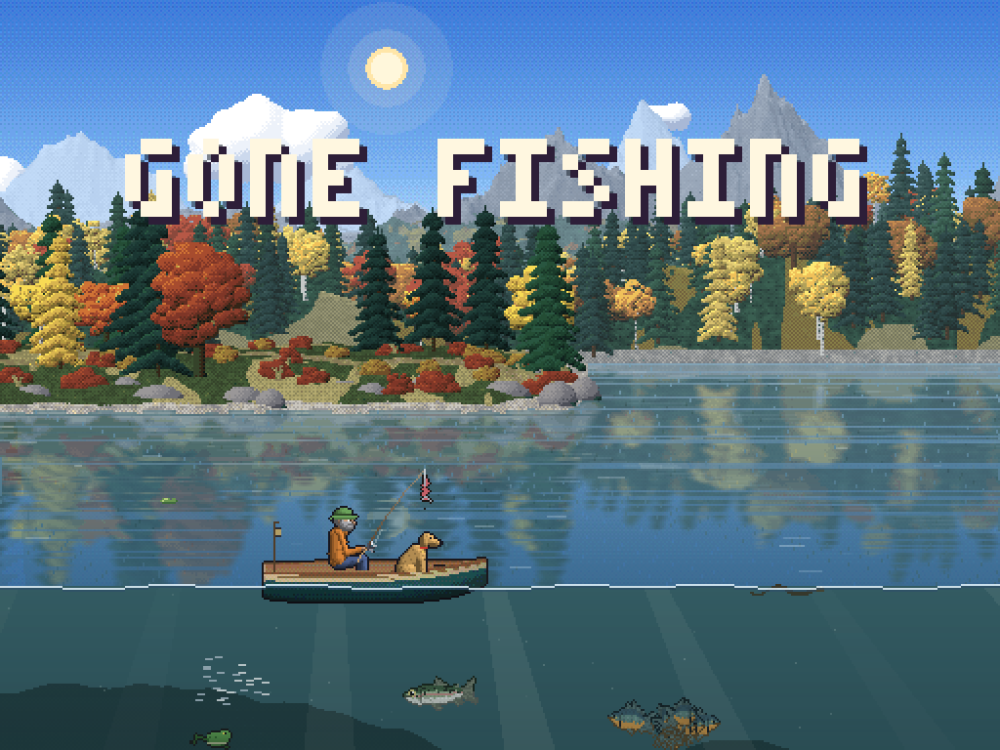
</p>

<h1 align="center">Gone Fishing</h1>

<p align="center">
  By <a href="https://github.com/SkyWalker541">SkyWalker541</a><br>
  A free, quiet pixel-art fishing game for PortMaster handhelds, made with LÖVE.<br>
  Tested on the <b>TrimUI Brick</b> (NextUI), and it should work on any device that runs <b>PortMaster</b>.<br>
  It also runs on any computer with LÖVE 11.5.
</p>

<p align="center">
  <a href="https://creativecommons.org/licenses/by-nc-nd/4.0/"></a>
</p>

<p align="center">
  <a href="https://github.com/SkyWalker541/Gone-Fishing/releases/latest"><b>Download the latest release</b></a> ·
  <a href="#install-with-portmaster">Install</a> ·
  <a href="#controls">Controls</a> ·
  <a href="#trailer">Watch the trailer</a>
</p>

> **Updates:** Gone Fishing is still being worked on, and improvements and new features may be released.
> Check back here or on the [Releases page](https://github.com/SkyWalker541/Gone-Fishing/releases) now and then for updates.
> Updating keeps your saves; see [Updating](#updating). Current version: **v1.4.1**, see [what's new](CHANGELOG.md).

## Trailer

https://github.com/user-attachments/assets/41486468-13db-4d01-acbd-5987c6e74fc5

<p align="center"><sub>Full quality: <a href="media/trailer.mp4">trailer.mp4</a> (download)</sub></p>

---

## About the game

Row out onto the water, look down at the fish swimming under your boat, and put your lure where they are. Let line out
to sink deeper, reel to bring it up, and strike when one bites. Every fish fights in its own way, so ease off when it pulls
or the line will snap. Sell your catch, upgrade your gear, dress up your angler and bring a dog or a cat along.

There's no timer and no pressure. Leave it on **idle fishing** and it fishes on its own.

### Features

- **Five places**, each eight screens long, with the scenery changing as you travel:
  - **Pine Lake**: an autumn lake under snowy peaks.
  - **Willow River**: a summer river with stony runs and a current that carries your line.
  - **Driftwood Bay**: an ocean bay with a lighthouse and big fish.
  - **Frost Lake**: a winter lake with ice floes and the northern lights.
  - **Columbia River** at Hood River, Oregon: Mt. Hood drawn from survey data, the Hood River Bridge with its lift span, kiteboarders on the wind, and the river's real fish.
- **42 fish** with their own behaviour and fight, including smallmouth bass, walleye, steelhead, chinook and coho salmon, and white sturgeon. **Five legends** each take only one lure.
- **Ten lures**, each fished its own way: worms and stink bait left still for fish to nibble or smell, spinners, spoons and diving cranks reeled for fish to chase, jigs dropped to the bottom and hopped, topwater poppers and a dry fly that fish rise to, a glow jig for the dark, and a trolling plug. The tackle box says how to fish each one and whether it works under a bobber.
- **Real fishing physics:** casts slowed by air drag and line off the spool (heavier lures fly farther), lures that sink on the slack and hold their depth (jigs and bait drop to the bottom), line you feed out or wind in to set the depth, a clicking drag when a fish takes line, and nibbles before the bite.
- **Bobbers:** fit a slip bobber to hang your bait at a set depth and watch it twitch and go under when a fish bites.
- **Boats and trolling motors:**
  - Row the wooden rowboat, or buy a skiff or a workboat.
  - Fit a **Trolling Motor** to steer by hand.
  - The **Auto Trolling Motor** can also troll on its own while you fish, with a speed setting: it backs the boat slowly away from your cast and tows the lure, and diving lures swim down to their depth.
- **Day and night, weather and seasons:** sunrises, storms, fog, snow, fireflies and moonlight on the water.
- **A tackle box** with:
  - A cooler.
  - A shop.
  - Gear.
  - Goals and daily tasks.
  - A logbook of every species.
  - A map.
  - A look editor.
  - Settings.
- **Your angler, your way:**
  - Build, skin tone, eye color.
  - 14 hairstyles and facial hair.
  - 11 hats, glasses, tops, vests, neckwear, pants and boots.
  - A retriever, spitz, shorthair or longhair cat as a companion.
  - The preview zooms in on whatever you're changing.
- **Three save slots**, each with its own name typed on an on-screen keyboard, safe deleting with a double confirmation, and **Exit to title** (Settings → Save and exit) to switch saves.
- **Sound:** recorded ambience for each place, a shuffled soundtrack, and separate volume levels for music, sound effects and nature sounds.

## Screenshots

| | |
|:--:|:--:|
| 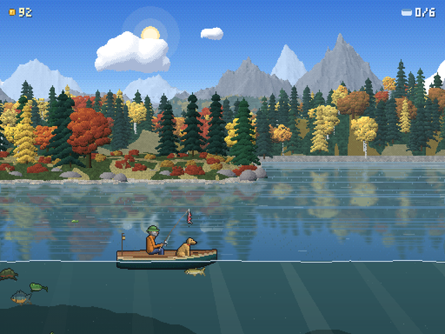 | 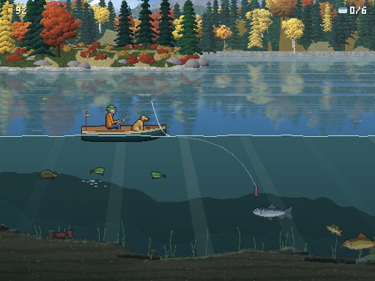 |
| Pine Lake | Watching the fish below the boat |
| 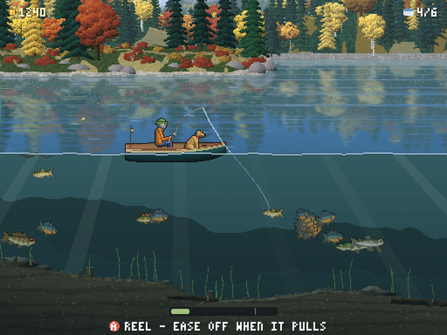 | 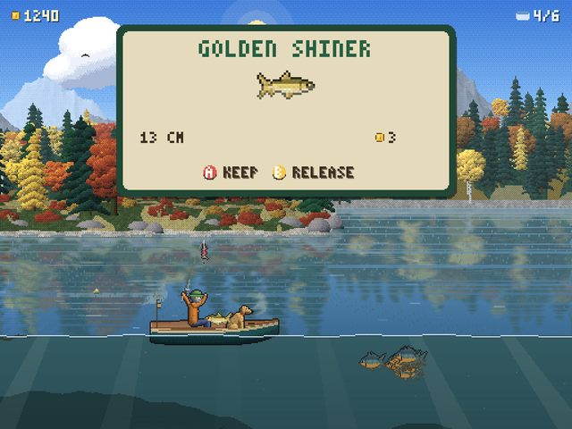 |
| The fight | A new species |
| 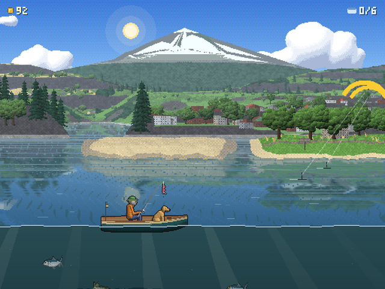 | 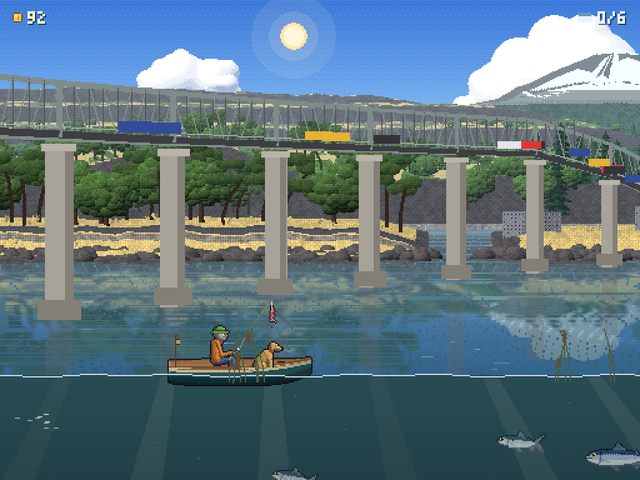 |
| The Columbia River and Mt. Hood | The Hood River Bridge |
| 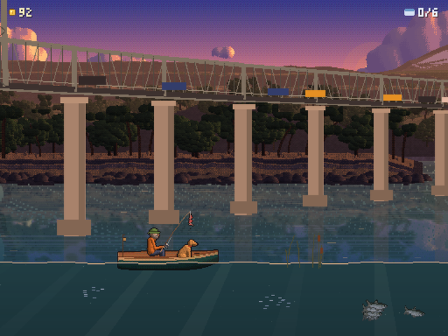 | 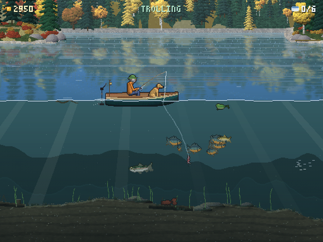 |
| Sunset on the Columbia | Trolling a lure behind the boat |
| 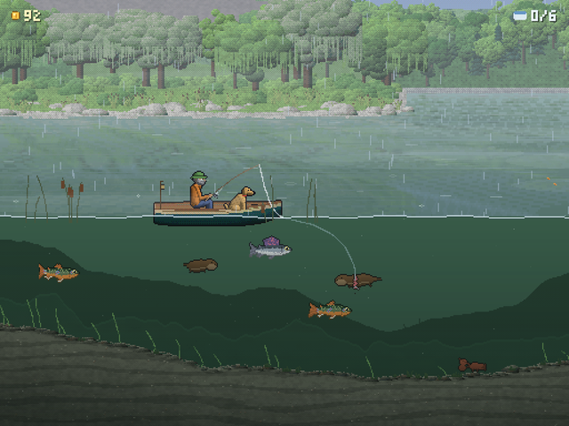 | 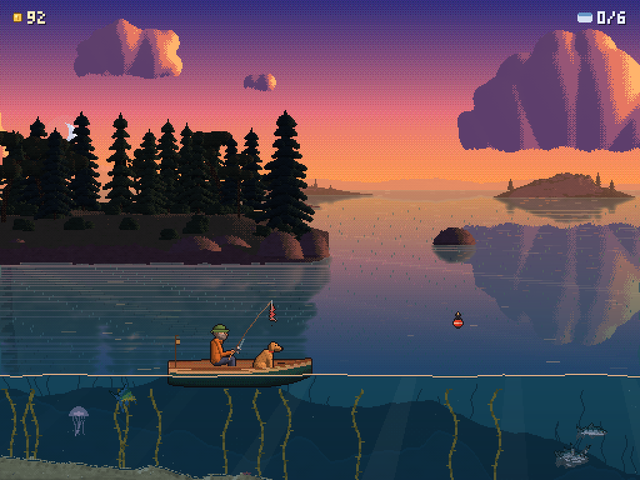 |
| Willow River in the rain | Driftwood Bay at sunset |
| 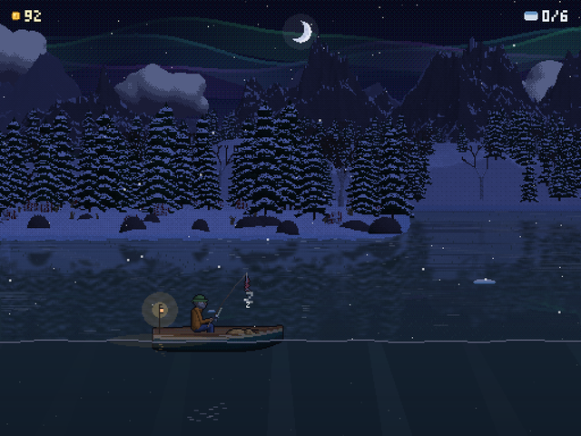 | 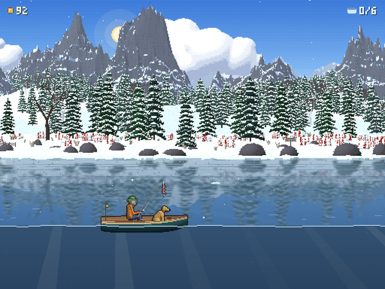 |
| Northern lights over Frost Lake | Frost Lake |
| 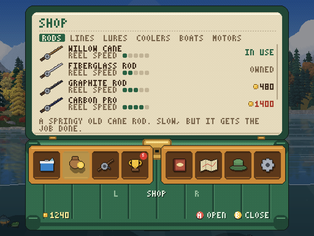 | 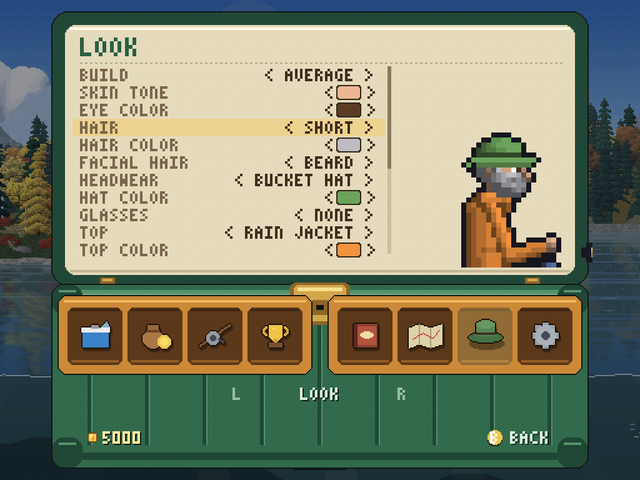 |
| The shop | Dressing up your angler |
| 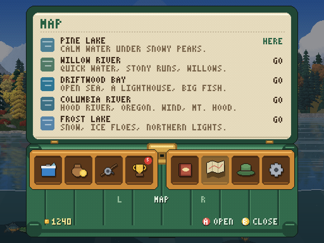 | 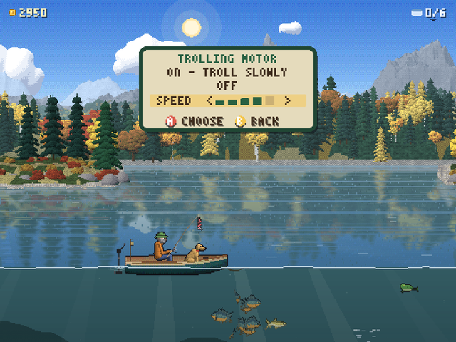 |
| Travel between places | The trolling motor menu |

## Install with PortMaster

Gone Fishing is a standard PortMaster port (LÖVE 11.5 runtime, aarch64 and x86_64). It has been tested on the
**TrimUI Brick** running **NextUI**, and it should work on any handheld that runs PortMaster.

You need PortMaster on your device and `gonefishing.zip` from the [latest release](https://github.com/SkyWalker541/Gone-Fishing/releases/latest).

1. **Unzip `gonefishing.zip`** on your computer. You get:
   - `Gone Fishing.sh` (the launcher)
   - `gonefishing/` (the game folder)
2. **Copy both** into your device's PortMaster ports folder, the same place your other ports live.
   On most systems that's the `ports` folder on the SD card; the launcher and the `gonefishing/` folder go side by side.
3. **Play:** open **Ports** and pick **Gone Fishing**.

### NextUI (TrimUI Brick, tested)

On NextUI the launcher and the game folder go in different places:

1. **Install PortMaster** if you don't have it. On the device, open the **Pak Store** and install **PortMaster** (listed as "PORTS"). Then open **Ports** once so it can finish setting up.
2. **Copy the files to the SD card:**

   | Copy | To |
   |--|--|
   | `Gone Fishing.sh` | `/Roms/Ports (PORTS)/` |
   | `gonefishing/` | `/Roms/Ports (PORTS)/.ports/` |

   `.ports` is a hidden folder. Show hidden files with **Cmd + Shift + .** on a Mac, or **View > Show > Hidden items** on Windows. Create the folder if it isn't there yet.
3. **Play:** put the card back in, open **Ports** and pick **Gone Fishing**.

When you're done, the SD card should look like this:
```
Roms/
└── Ports (PORTS)/
    ├── Gone Fishing.sh
    └── .ports/
        └── gonefishing/
            ├── gonefishing.love
            ├── gonefishing.gptk
            ├── licenses/
            └── saves/        (created the first time you play)
```

Plain-text NextUI instructions are also in [INSTALL_NEXTUI.txt](INSTALL_NEXTUI.txt).

### On a computer

Install [LÖVE 11.5](https://love2d.org/) and open the game file with it:

```sh
love gonefishing/gonefishing.love
```

Keyboard: arrows move, **Z** casts and reels, **X** reels fast and goes back, **C** pets, **V** opens the trolling menu,
**Enter** opens the tackle box, **Q / E** switch sections.

## Controls

| Button | Action |
|--|--|
| D-pad Left / Right | Row the boat, or drive with a trolling motor |
| A | Hold to cast, hold to reel, press to strike |
| Down / Up | Let line out (lure sinks deeper) / reel in (lure lifts). With a bobber: set the depth |
| B | Reel fast / release a catch / back |
| X | Pet your dog or cat |
| Y | Trolling motor menu: on/off and speed (needs the Auto Trolling Motor) |
| Start | Open the tackle box |
| L / R | Tackle box sections |

A, B, X, Y and Start can be remapped in **Settings > Controls**. If A/B and X/Y are labelled the other way round on your device, set **Button layout** to **Swapped** on the same page.

## Updating

New versions are posted on the [Releases page](https://github.com/SkyWalker541/Gone-Fishing/releases). To update, copy the new `Gone Fishing.sh` and
`gonefishing/` folder over the old ones. Your progress, all three save slots, is kept in `gonefishing/saves/`, so leave that folder in place.

## Repository layout

This repository is laid out exactly as a PortMaster port:

```
Gone Fishing.sh       the PortMaster launcher
port.json             PortMaster port info
gameinfo.xml          game list entry (name, description, cover)
README.md             PortMaster notes and controls
cover.jpg             cover art
screenshot.png        screenshot (640x480)
gonefishing/
├── gonefishing.love  the whole game in one file (LÖVE 11.5)
├── gonefishing.gptk  button map
└── licenses/         license files
.github/              this page, screenshots and the trailer (not part of the port)
```

The release download (`gonefishing.zip`) is these same files: the launcher and the `gonefishing/` folder, with the
port files inside it.

### Playing on a computer

Install [LÖVE 11.5](https://love2d.org/) and open `gonefishing/gonefishing.love` with it (or run
`love gonefishing/gonefishing.love`).

## Credits and license

- Gone Fishing is © 2026 SkyWalker541 and licensed under [CC BY-NC-ND 4.0](https://creativecommons.org/licenses/by-nc-nd/4.0/):
  free to download and share, but it may not be sold or charged for, and modified versions may not be shared.
  See [LICENSE](../gonefishing/licenses/LICENSE.gonefishing.txt) for details, including permission for PortMaster packaging.
- Made by [SkyWalker541](https://github.com/SkyWalker541). All sounds and music were made by SkyWalker541 with AI tools and in code.
- Third-party licenses (LÖVE, gptokeyb): [gonefishing/licenses](../gonefishing/licenses).
- Thanks to the [LÖVE](https://love2d.org/) team and [PortMaster](https://portmaster.games/).

All characters, names and places are original, except the real Columbia River, Hood River, Mt. Hood and the
Hood River Bridge, drawn as a tribute to the Columbia River Gorge.
